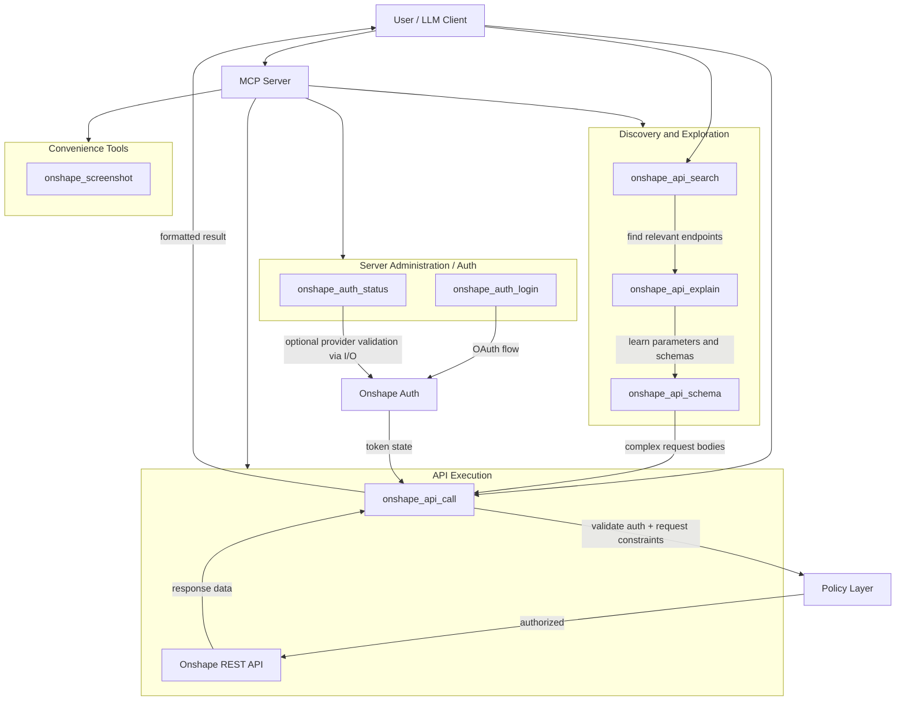
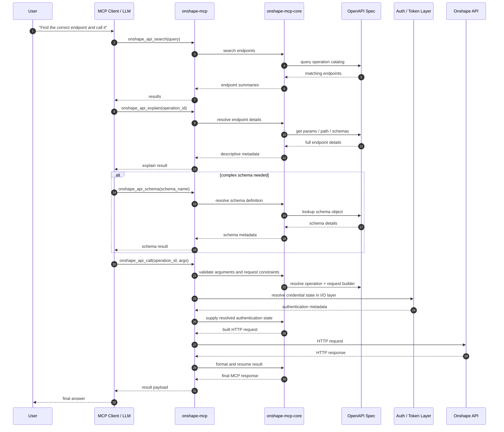

# Project Overview

This project is a Rust-based MCP (Model Context Protocol) server for Onshape. The main purpose is to let an AI assistant discover, inspect, and execute Onshape API operations in a controlled and structured way.

The recommended transport is local stdio. Experimental Streamable HTTP is also available for self-hosted setups, but no public hosted service is provided.

## What Node does

Node is not the main implementation layer. It acts as the launcher and distribution wrapper around the Rust binary. The npm package can detect the current platform and architecture, locate a local Rust build or bundled platform binary, and then start the actual server process.

This is why `npx --yes onshape-mcp` can work without a separate local build step in many cases. The npm package is primarily a way to install and run the Rust application consistently across platforms.

## What Rust does

Rust is the real implementation of the project. It contains the MCP server, the Onshape API integration, the authentication flow, the OpenAPI-driven tool layer, and the runtime logic for requests.

The workspace is organized into crates, with a clear separation between pure logic and I/O:

- `onshape-mcp`: application binary and orchestration
- `onshape-mcp-io`: transport and I/O glue (`tokio`, `rmcp`)
- `onshape-mcp-core`: pure protocol/business logic, no I/O
- `onshape-client-io`: HTTP client for Onshape
- `onshape-client-core`: pure Onshape API logic and types

This follows the project's Sans-IO design philosophy: business logic is isolated from network, filesystem, and async execution so it can be tested deterministically.

## Architecture and design goals

The project is designed around a layered architecture and a generic API tool model rather than a large number of hard-coded endpoint-specific MCP tools.

The main idea is:

- search for a relevant Onshape API endpoint
- explain its parameters and schemas
- inspect the request/response structure if needed
- execute the call dynamically from the OpenAPI specification

That keeps the interface compact while still exposing the full Onshape API surface.

## MCP call model

The server exposes a small number of generic tools, instead of one tool per endpoint:

- `onshape_api_search`: find relevant endpoints by keyword, method, or tag
- `onshape_api_explain`: get full details for a specific endpoint
- `onshape_api_schema`: inspect schema definitions such as BTType objects
- `onshape_api_call`: build and execute an Onshape HTTP request
- `onshape_auth_status` / `onshape_auth_login`: authentication and session state
- `onshape_screenshot`: convenience helper tool

### Call flow overview

## Runtime behavior: discovery to execution

The request path is intentionally dynamic. The API call is assembled at runtime from the OpenAPI description instead of being hard-coded for each endpoint.

## Externally managed credentials

Optional external-token mode receives only access-token metadata from an external
OAuth owner. Token loading, expiry checks and provider execution happen in the
I/O layer; core logic consumes authentication state and produces request effects.
The server does not initiate OAuth or refresh tokens in this mode.

External-token mode exposes the generic API tools and auth status, with exact
read-target restrictions and optional revision-bound existing-feature updates.
It omits login, screenshot and file access. See the fork's
[target policy](../../target-policy.md) for security semantics. Other
supported authentication modes retain the upstream tool surface.

## Summary

This project separates concerns cleanly:

- Node handles wrapper/distribution
- Rust handles the real MCP server logic and Onshape integration
- OpenAPI-driven discovery and execution keep the tool surface small and expressive
- Sans-IO and layered architecture keep the system testable and maintainable
